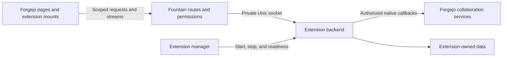

# Fountain

**Forgejo with native extensions.**

Fountain is a maintained [Forgejo](https://forgejo.org/) fork that lets you build
applications into your software forge. It combines Forgejo's Git hosting, issues,
pull requests, organizations, permissions, Actions, and package registry with
independently installed extension backends and browser interfaces.

An extension can add a repository workspace, keep a panel open while someone
browses issues and code, or run authorized background operations against native
repositories. Fountain supplies the integration with Forgejo; each extension owns
its application logic, interface, and data. Installing an extension does not
require rebuilding the host.

The extension interfaces are under active development. The maintained branch is
[`codex/fountain-extensions`](https://github.com/veighnsche/forgejo-ext/tree/codex/fountain-extensions).
Use a matching host and SDK source revision when building an integration.

## What Fountain adds

| Capability | What it provides |
| --- | --- |
| Native pages | Global, repository, user-settings, and administrator contributions in Forgejo's layouts and navigation, with declared subroutes. |
| Persistent panels | Browser components that retain their DOM, local state, and streams across supported native page transitions. A page and panel can share one retained instance. |
| Extension backends | Separately built executables with a lifecycle handshake, private Unix-socket transport, and a persistent data directory. |
| Native identity and access | Session-aware HTTP and WebSocket requests, current actor and repository reads, and contribution permissions checked by the host. |
| Background collaboration | An independent authorization path for native snapshots and conditional issue, Git, pull-request, review, and merge operations. |
| Package lifecycle | Local installation, verified catalog acquisition, live administrator enable/disable, required-package readiness, and persisted requested state. |

The bundled [example application](contrib/extensions/example) demonstrates scoped
pages and a persistent notes panel. [SodaOS](https://github.com/LevitateOS/sodaos)
is a downstream consumer that supplies its own workspace, automation, and
appliance integration. Fountain can run independently; its release image includes
the forge and extension host without preinstalling Soda's application packages.

## How an extension works



A package contains an `extension.json` manifest and an executable. Packages that
contribute UI also include browser assets:

```text
example/
├── extension.json
├── backend
└── assets/
    ├── page.js
    └── panel.js
```

The [manifest](sdk/manifest.go) declares identity, capabilities, pages, panels,
permissions, and optional lifecycle-controller relationships. Fountain validates
the package, starts its backend, and serves its contributions through native
routes. The backend implements the lifecycle handshake and private HTTP interface;
the [Go SDK](sdk) provides these through `Serve(Application)` and uses HashiCorp
go-plugin for the control handshake.

Browser modules export `mount(root, context)`. The host supplies scoped `request`,
`stream`, and `navigate` functions and drives the component's lifecycle. The
[TypeScript contract](sdk/browser/extension-contract.d.ts) describes presentation
updates, suspension, resumption, and retirement. It is a type-only interface; the
host provides the runtime helpers.

The host manages package processes and admission. Extensions own their workflows
and persistent data, accessed through the SDK's `DataDir()`. Forgejo's database
and internal service packages remain behind the native API boundary.

## Native UI and permissions

Pages occupy host-defined routes. A manifest selects a slot and may declare
bounded subordinate routes, such as `/workspace/requests/{request}`.

| Scope | Available page routes |
| --- | --- |
| Global | `/workspace`, `/feed`, `/applications`, `/tailnet` |
| Repository | `/{owner}/{repo}/workspace` |
| User settings | `/user/settings/workspace`, `/user/settings/identity` |
| Administrator | `/admin/workspace` |

Route claims must be unique within their scope. Contributions use Forgejo's
signed-in browser session and native account, repository, and administrator
checks. An extension can further restrict access through a contribution
authorizer. Observing a repository in the browser context does not grant
permission to operate on it.

Persistent panels retain their mounted root and resources during supported
navigation. A shared page/panel owner changes presentation without creating a
second application instance. Session changes and revoked access retire affected
mounts and transports. Authentication flows, errors, and routes outside the
supported transition contract retain normal document navigation. The
[extension guide](contrib/extensions/README.md#browser-lifecycle) describes the
browser contract and its current coverage.

**Extensions are administrator-trusted code.** Their backend runs as the host's
OS user, and their JavaScript executes on the forge's origin. Process separation
provides lifecycle management, not a sandbox for untrusted packages.

## Background collaboration

Background work has its own installation identity and authorization, independent
of a browser tab. Supported clients use the private callback transport, enrolled
native actors, and scoped credentials. Closing a browser session does not grant
or revoke those separate background permissions; installation, actor, token,
repository, and operation checks still apply.

The [native operation service](services/nativeoperation) supports:

- Creating and editing issues and changing their dependency graph.
- Publishing Git refs and creating pull requests.
- Submitting reviews, resolving review threads, and requesting reviewers.
- Applying issue lifecycle changes and publishing comments.
- Merging an exact pull-request candidate using fast-forward-only semantics.

Clients can read native snapshots of issues, comments, dependencies, pull
requests, reviews, checks, refs, ancestry, and permissions. Writes carry an
operation identity, expected native revision, and deadline. Repeating an
identical operation returns its recorded result; changing its intent under the
same ID is rejected. The operation ledger records effects, cancellation, and
completion separately so callers can distinguish an uncommitted write from an
uncertain or partially completed outcome.

Fountain owns native authorization and collaboration effects. The extension
decides what work to request and manages its own planning, execution, and policy.
See the [background SDK](sdk/background.go), [snapshot types](sdk/snapshot.go),
and [supported-operation handshake](sdk/operations.go) for the concrete contracts.

Human extensions can prepare an ordinary issue/PR comment with
[`Authority.RepositoryCommentSnapshot`](sdk/native_comment_snapshot.go). The
session-admitted callback returns exact parent/actor identities, current comment
capability and a native revision observed idle on both sides of the read. It
rechecks parent and human facts and refuses changed or busy state. Preparation
records no comment or operation and grants no write authority. A journaled human
comment consumer must claim that revision and recheck admission/permission at
commit. The native [`SubmitHumanComment`](services/nativeoperation/human_comment.go)
service now provides the conditional comment/receipt transaction, current human
and parent checks, identical replay, native mention/notification completion and
offline recovery without publishing a duplicate. Its trusted caller must supply
live human/session/installation admission on every call and at commit.
[`Authority.SubmitHumanComment`, `GetHumanComment` and `CancelHumanComment`](sdk/native_human_comment.go)
now consume this service through the private callback. Packages must declare
`native.repository.comments.write`; submit/cancel need a native POST admission.
Use `HumanCommentOperationID` with native actor/repository IDs and persist that
ID and immutable intent before dispatch. The host derives the installation from
the live package instance. A lost reply requires lookup under the saved ID;
`not_observed` does not prove that no earlier effect can arrive. Receipt lookup
and cancellation retain current-human/instance checks after repository permission
loss. Soda's shared application/HTTP comment consumer is implemented; installed
UI and desktop gateway qualification remain later work. This kind is not advertised for background enrollment.
The existing completion-note operation retains its merge/closed-issue contract.

[`Authority.RepositoryEditSnapshot`](sdk/native_edit_snapshot.go) prepares human
issue/PR title and description edits with exact original title, full-body digest,
content version, parent IDs and separate title/body capabilities. The native
[`SubmitHumanEdit`](services/nativeoperation/human_edit.go) producer accepts only
explicitly supplied fields: omitted means unchanged, an empty body clears it.
Titles are bounded to the native storage's 255-byte limit, without truncation;
new bodies are bounded to 64 KiB of original UTF-8 Markdown. It rechecks live
human admission and each requested field's native permission, then commits both
fields, native history and receipt atomically through the existing journal.
Replay retains that receipt; inhibited offline recovery never reapplies an edit
or repeats uncertain completion. Native title notification/code-owner handling
is shared with ordinary title changes. The request/receipt and exact intent codec
live in [`sdk/native_human_edit.go`](sdk/native_human_edit.go). This human kind
has no background enrollment. `Authority.SubmitHumanEdit`, `GetHumanEdit` and
`CancelHumanEdit` now consume this service through the private callback. Packages
declare `native.repository.discussions.edit`; submit/cancel require native POST
admission and the installation captured before dispatch. `HumanEditOperationID`
binds the command to its native human/repository. The host rechecks the live
installation at commit, and lookup reports the live namespace even for absence;
a replacement installation cannot reconcile an earlier installation's outcome.
Own-operation lookup/cancel retain current-human admission after repository
permission loss. Soda's canonical edit journal/adapter/application/HTTP consumer
is implemented; installed editor and desktop gateway qualification remain later
work. Preparation itself grants no write authority.

[`Authority.RepositoryIssueCreateSnapshot`](sdk/native_issue_create_snapshot.go)
prepares ordinary human issue creation with the exact current actor/repository,
internal-issue capability and an idle native revision. It follows native reader,
archive and owner-block rules, rechecks both sides of the read and allocates no
issue/index or operation. It works without an existing issue or code unit at this
private metadata boundary. Full issue-only extension admission remains separate.
The native [`SubmitHumanIssueCreate`](services/nativeoperation/human_issue_create.go)
producer now creates a plain issue through the existing conditional journal,
with live human/reader/archive/block checks and one SQL transaction for index,
issue and receipt. Replay returns the recorded issue; offline recovery never
recreates it or repeats uncertain notifications. It is excluded from background
enrollment. The typed SDK now supplies `SubmitHumanIssueCreate`,
`GetHumanIssueCreate` and `CancelHumanIssueCreate` through the private callback,
requiring `native.repository.issues.create`, scoped actor/repository operation
IDs and captured installation equality for submit/cancel. Live native human,
instance and request admission is checked at commit and before returning results.
Own-operation lookup/cancel remains available after repository permission loss;
lookup reports the current installation even for absence. The shared Factory
application now retains validated creation outcomes against its saved capture;
its admitted shared HTTP consumer is implemented, with installed UI and desktop
gateway qualification still subsequent work. Preparation grants no
creation, automation or spending authority.

[`Authority.RepositoryLockSnapshot`](sdk/native_lock_snapshot.go) observes the
current issue/PR comment-lock state, exact subject/wrapper IDs and separate
lock/unlock capabilities under an idle native revision. It follows native
subject-read, writer-or-Issues/PR and archive rules; authorship alone does not
grant locking. Fresh reads bracket state/permission/current-human facts and
reject changed observations. It performs no lock mutation or operation claim.
The native [`SubmitHumanLock`](services/nativeoperation/human_lock.go) producer
now uses live human admission and the existing conditional journal. Current lock
state and configured reasons are rechecked; native lock state, history and the
receipt commit atomically. Recovery verifies the exact state/history and never
reapplies the mutation. There is no separate notification step, so a proved
committed primary can finish/release offline. This kind is excluded from
background enrollment. The SDK now exposes `SubmitHumanLock`, `GetHumanLock`
and `CancelHumanLock` through the private callback under
`native.repository.discussions.lock`. Scoped actor/repository operation IDs and
captured installation equality protect submit/cancel; lookup returns the live
installation even for absence. Current instance, human/session and request
admission are rechecked inside primary and before releasing results. This
capability is now declared by the Factory product. Canonical lock capture and
the Fountain adapter feed its shared Application and admitted HTTP consumer with
durable validated outcomes and live admission on receipt recovery. The real
frontend/Unix bridge also admits the scoped lock routes and bounded request
envelope. Installed UI and desktop HTTPS qualification remain subsequent work.

[`Authority.RepositoryStateSnapshot`](sdk/native_state_snapshot.go) prepares
direct issue/PR close/reopen with exact native subject/wrapper IDs, closed and
merged state, separate close/reopen facts and an idle native revision. It follows
native EditIssue/EditPullRequest state permission and ChangeIssueStatus block/
dependency rules, with enabled subject reads and archive checks. Author rights
exclude imported poster identity; current owner/poster blocks deny both actions.
Enabled open dependencies deny closing while reopening remains available.
Comment locks do not gate this direct state API. Preparation is read-only and
grants no authority. Native `SubmitHumanState` now uses live human admission and
the existing conditional journal: status, native history and its typed receipt
commit together. Native counts derive from issue state and invalidate after
commit. Stopwatch/notification completion follows the primary; a failure or
interrupted completion retains a committed receipt needing intervention. Offline
recovery checks exact state/history and never repeats primary or uncertain
completion. The SDK now exposes `SubmitHumanState`, `GetHumanState` and
`CancelHumanState` through the private callback under
`native.repository.discussions.state`. Actor/repository-scoped operation IDs
and captured installation equality protect writes; lookup reports the live
installation even for absence. Current human/session, instance and request
admission are rechecked inside primary and before releasing results. The
Factory production manifest now declares this capability. Canonical
Factory state-command capture now retains exact intent/preparation in its
existing immutable journal, with concurrent-winner replay and real PostgreSQL
restart/recovery checks. Factory's `forgejo.HumanStates` adapter now consumes
this SDK through the neutral human state writer port, preserving native receipt
bytes and completion intervention separately from canonical identity/digest
bindings. `Application.HumanStates` now delivers through that adapter and retains
validated observations in Factory's existing command journal, preserving original
receipts and unresolved completion through reply loss, concurrency and Store
reopen. Shared HTTP now consumes that Application through admitted Fountain
Product/frontend composition, with strict boolean input, safe scoped results,
ordinary body bounds and unfinished completion retained across reply loss and
reopen. Current native session is rechecked after delivery. Installed UI and
desktop HTTPS qualification remain subsequent work.
Combined comment posting and the web comment route's PR ref synchronization are
separate operations.

[`Authority.RepositoryReviewSnapshot`](sdk/native_review_snapshot.go) now prepares
human PR review work with exact PR/issue identities, current base-branch and PR
head commits, a Git-derived merge base and an idle native revision. It exposes
only the current human's pending draft ID/commit, with separate comment, draft,
approve and request-changes facts. Native code/PR reads, self-review, imported
poster, owner/poster blocks and archive rules apply. Reviewable base-repository
PR refs do not disclose private fork IDs/branch names or another user's draft.
Two complete reads compare public preparation and private source/author facts;
Git, draft, identity, permission, revision and current-session races refuse.
Preparation creates no review/comment/operation and grants no write authority.
[`SubmitPreparedHumanReview`](models/issues/review_human_primary.go) now provides
the native SQL primary under an explicit held ownership generation. Drafts create
or update only the human's own pending row, preserving original commit/inline
context; final comment/approve/request-changes reuse native submission and
approval/request bookkeeping, including fork PRs. Exact target/current Git proof,
own draft identity and native live policy are checked before effects. The primary
joins its caller's transaction, so review/history/bookkeeping and a later journal
receipt can commit together. Actual native SQL and outer rollback checks pass.
`Service.SubmitHumanReview` now composes that primary with live human admission,
the native conditional reservation/journal and an atomic typed receipt. The shared
SDK codec retains exact intent, body digest, native review/history identity,
official/stale flags and a composite digest/count of all retained draft inline
evidence. Drafts need no notification step; final reviews perform ordinary native
mention/notification completion after commit, preserving intervention on failure.
Offline SQL-evidence recovery never repeats primary or uncertain completion;
unadmitted pending transactions recover no effect and mismatched evidence stays
fenced. Actual native delivery/replay/refusal/rollback and returned-writer recovery
checks pass. Six actual owned-child SIGKILL/reap cases now qualify persistent
database/Git reopen before and after draft creation, draft update and final
submission. Exact receipt/row/history/inline/anchor mismatches stay fenced;
restoring original evidence permits recovery. Draft updates preserve original
commit/stale state, while uncertain final completion remains intervention without
replaying primary or mentions/notifications.
The SDK now supplies scoped human review submit/get/cancel over the live private
callback with captured installation equality, current native human/session and
exact intent/receipt validation. The catalog recognizes
`native.repository.reviews.write`; the production Factory source manifest now
declares it for the shared admitted HTTP consumer. Actual private-channel checks qualify native draft/final
reviews, escaped 64 KiB prose, lost replies, Git/permission/session refusal,
completion intervention without replay and genuine manager/installation
replacement. SQL proves eight final reviews/history entries without duplicates
or retried mention work. Factory now owns durable canonical review capture and
an admitted review adapter with separate canonical/native bindings. Real
PostgreSQL and private callback checks retain original inline context and recover
lost replies after Store reopen. The shared Application now retains review
outcomes monotonically, qualifying concurrent submission, scoped cleanup and
intervention across reopen. Shared HTTP now joins the same admitted Product and
Application through the frontend/private Unix path, with strict prose/event input,
safe result projection, both reply-loss recoveries and post-commit current-session
refusal. New inline creation, installed review UI and desktop HTTPS remain
subsequent work.

`Authority.RepositoryInlineSnapshot` now prepares an exact immutable inline
selection with current PR/Git/draft/policy facts, literal path, old/new side and
file or line range. Two complete private/public source and Git proofs bracketed
by idle native revision refuse live races. The reusable native proof validates
actual tree entry and diff membership, retaining entry identity and diff digest
without exposing source text or private fork/draft details. File-level large,
binary and gitlink context uses bounded metadata; lines need complete textual
hunk coverage within a 4 MiB proof bound. EOF phantom lines and hunk gaps refuse;
genuine blank context remains anchorable. Actual SDK/private callback checks
qualify these cases, permissions/session/draft/Git races and absence of read
effects. This grants no write authority.
`CreatePreparedHumanInlineComment` now supplies an ownership-required SQL primary
with shared current review/actor/repository/draft validation and exact captured
versus trusted-current Git/anchor proof. It stores full original file/side/range
context, preserves own older draft summary/commit/inline data, and supports draft
append or immediate native review finalization with preserved summary. Actual
native SQL, outer rollback, comment/history INSERT failure and review-primary
regression checks pass. Native thread grouping and private human reads now
distinguish entire immutable file/side/range/tree contexts sharing a legacy
coordinate. Unambiguous retained replies stay grouped without inventing original
context; ambiguous unknown replies remain separate. Prose paging rechecks whole
group membership, including off-page context and root-order changes. The older
location-only native reply form refuses ambiguous conversations and preserves
unknown commit/patch metadata. Real SQL/Git/Unix SDK and native root-resolution
checks cover these boundaries. Automation snapshots now retain full immutable
file/side/range/tree context per root and member, separate from recorded native
coordinates. Complete conversation digests include each original anchor (null
when unknown) and member resolver state. Native conditional file/range resolution
uses that exact evidence. Factory delivery translates it to neutral records and
recomputes the complete digest from authenticated bodies before using the material.
Changed original context refuses resolution; the native and canonical digest
encoders agree for unknown, file and range contexts.
The native human inline journal now composes current request admission, fresh
held Git/anchor proof, prepared SQL and an exact bounded receipt. Draft appends
preserve the own summary/older commit and original comments; immediate publication
consumes that own draft through native review history and completion. Exact replay
does not append another comment or retry uncertain notifications. Offline recovery
matches the receipt, inline/review/history and complete retained comment evidence,
including original context, content version, resolver state and timestamps.
Real native SQL/Git checks cover rollback, replay, cancellation, partial completion
and stopped-writer evidence recovery. Eight owned-worker SIGKILL/reap and persistent
reopen cases now qualify new drafts, retained draft appends and immediate publication
with and without an existing draft, before/after primary SQL. Exact receipt and
original context survive, changed evidence stays fenced, and recovery/replay adds
no duplicate inline/history or uncertain mention completion.
`Authority.SubmitHumanInline`, `GetHumanInline` and `CancelHumanInline` now expose
the producer on the admitted private callback under the existing human-review
capability. Actor/repository-scoped IDs own both submissions and early cancellation
tombstones. Submit/cancel assert the captured installation; lookup reports the live
installation even for absence. Current human/request/manager admission is checked
before effects and after completion, with fresh native policy inside primary SQL.
SDK validation binds exact intent/receipt and immutable context. Actual manager/
Unix/SQL/Git checks cover large prose, file/range drafts and immediate publication,
lost replies, changed admission, partial completion and genuine package replacement
without adopting another installation's journal. Canonical capture, provider
adapter, Application/HTTP and installed UI consumers remain subsequent work.

`Authority.RepositoryThreadSnapshot` now prepares resolve/unresolve for an exact
native thread root. It reuses native immutable-context grouping, PR/Git reads and
`CanMarkConversation`, with separate resolve/unresolve policy and archive refusal.
Complete conversation and metadata digests pin prose/version/order, original
anchors, exact resolver identity and native review/author/time/commit facts.
Retained unknown original context stays null; foreign pending reviews stay hidden.
At most 1,000 selected members and 2 MiB aggregate prose/retained patches are proved; larger
conversations refuse instead of returning partial evidence. Two full observations,
idle revision checks and a final live-human check fence concurrent changes.
Actual SQL/Git/private SDK checks qualify full file/side/range/tree separation,
legacy context, draft privacy, policy, bounds and live races without read effects.
This preparation grants no authority. `ApplyPreparedHumanThread` now supplies an
ownership-required native resolve/unresolve primary. It binds the trusted current
actor and captured revision, repeats native policy/Git/conversation proofs in a
joined transaction and uses native root-only `MarkConversation`. Predicted exact
read-back preserves existing resolvers on no-op resolution and retains unknown
anchors, original prose/patch/author facts and review/draft metadata. Actual SQL/
Git checks qualify stale/admission refusal, no-op preservation, outer/SQL failure
and unexpected-data rollback. `SubmitHumanThread` now joins root resolution and
its exact before/after receipt in the existing installation-bound native journal.
It orders cancellation and expiry against admission, preserves no-op receipts,
and withholds results when current human admission changes. Offline recovery
checks exact saved intent, receipt, scope and complete native post-state before
finishing bookkeeping; it never reapplies the mutation. Twelve owned-worker
SIGKILL/reap and persistent-reopen cases now qualify resolve/unresolve, both
no-ops, retained unknown context and own older drafts, before/after primary SQL.
Exact receipts and complete native rows survive; altered evidence remains fenced,
and recovery/replay never repeats the mutation. `Authority.SubmitHumanThread`,
`GetHumanThread` and `CancelHumanThread` now expose the producer on the admitted
private callback under the existing human-review capability. Actor/repository
operation IDs own early cancellation tombstones; submit/cancel assert the saved
installation while lookup reports the live installation even for absence.
SDK result validation binds exact intent/receipt and full or unknown context.
Actual manager/Unix/SQL/Git checks cover resolve/unresolve/no-ops, lost replies,
session changes and genuine package replacement without journal adoption.
Canonical capture/provider adapter, Application/HTTP and installed UI consumers
remain subsequent work.

`Authority.RepositoryManualMergeSnapshot` prepares a full commit already reachable
from the target branch. Declare `native.repository.merges.write` to call
`SubmitHumanManualMerge`, `GetHumanManualMerge` and `CancelHumanManualMerge` on the
admitted private callback. This capability is separate from human reviews and
does not replace current native merge permission. Submit/cancel assert the saved
installation; lookup reports the live installation even for absence. Capture the
command before dispatch and reuse it unchanged. Retries return journaled truth
without repeating metadata or notifications; partial completion remains visible.
Manual marking changes native PR metadata/history and leaves Git untouched.
SDK validation binds actor/repository/operation/digest and canonical receipt;
submit also binds the selected preparation. Actual manager/Unix/SQL/Git checks
cover lost replies, session withdrawal, malformed results and genuine package
replacement without adopting its predecessor's journal. Canonical application,
HTTP and installed UI consumers remain subsequent work.

`Authority.RepositoryMergeSnapshot` prepares ordinary merge, rebase,
rebase-merge, squash or fast-forward-only. `SubmitHumanMerge`, `GetHumanMerge`
and `CancelHumanMerge` use the same declared merge capability and live human
admission. The repository service supplies the existing native push owner:
one captured command stages, passes the generated prepared hooks, pushes and
completes native bookkeeping once. Receipts bind the method, target/head/base,
computed result/tree/parents and command digest; completion remains separate
from the primary ref effect. Actual managed SDK/Git checks cover all methods,
private forks, hook-time refusal, lost replies and installation replacement.
Identical retry never launches another push or notification.

## Build and try Fountain

Build from this repository's maintained branch. Install Git, GNU Make, a C
compiler, Go, and Node.js with npm; the repository records its toolchain inputs in
[go.mod](go.mod), [.node-version](.node-version), and
[package.json](package.json). The upstream
[build guide](https://forgejo.org/docs/next/contributor/from-source/) covers
platform prerequisites.

```sh
git clone --branch codex/fountain-extensions https://github.com/veighnsche/forgejo-ext.git fountain
cd fountain
npm ci
TAGS="bindata timetzdata sqlite sqlite_unlock_notify" make build
./gitea web
```

The Makefile retains the upstream `gitea` executable name. On a fresh local
installation, open `http://localhost:3000` and complete Forgejo's setup. Standard
forge administration is covered by the
[Forgejo administrator guide](https://forgejo.org/docs/latest/admin/).

### Try the example extension

From the source checkout, build its backend and check its browser entries:

```sh
mkdir -p .artifacts/packages/example/assets
go build -o .artifacts/packages/example/backend ./contrib/extensions/example
./node_modules/.bin/tsc -p sdk/browser
cp contrib/extensions/example/extension.json .artifacts/packages/example/
cp contrib/extensions/example/assets/*.js .artifacts/packages/example/assets/
```

Stop the local server and add this section to its `custom/conf/app.ini`:

```ini
[extensions]
ENABLED = true
PATH = data/extensions
```

Using the same configuration, work path, and service account as the server:

```sh
./gitea --config ./custom/conf/app.ini --work-path "$PWD" extensions install .artifacts/packages/example
./gitea --config ./custom/conf/app.ini --work-path "$PWD" extensions enable example
./gitea --config ./custom/conf/app.ini --work-path "$PWD" extensions list
./gitea --config ./custom/conf/app.ini --work-path "$PWD" web
```

Sign in and open `/workspace`. The example adds global, repository, user-settings,
and administrator pages plus a notes panel with per-user storage and an admitted
WebSocket stream. Its source imports the public SDK without importing the host's
models or services.

## Operating extensions

Extensions are disabled by default. `PATH` selects package storage; private data
lives under `PATH/.data/{id}` and survives replacement and disabling. Include
extension data in backups alongside the forge's normal persistent state.

The CLI handles local package installation, replacement, removal, and next-start
activation while the host is stopped. The running server's `/admin/extensions`
page can enable and disable optional packages without restarting Fountain.

For managed distribution, `CATALOG_PATH` selects a trusted catalog of HTTPS
archives with exact sizes and SHA-256 checksums. `REQUIRED_IDS` identifies
catalog packages that must be ready before the host reports readiness. Optional
packages reconcile after core startup; an optional backend failure isolates that
package. Required packages cannot be disabled through normal administrator
controls. Packages with external effects can use a declared lifecycle controller
for activation and cleanup.

The [lifecycle and release contract](docs/fountain-release.md#extension-lifecycle-contract-rcx-2)
covers catalog configuration, durable state, controllers, maintenance, and
recovery. The release tooling produces a native Linux amd64 image, executable,
source archives, and provenance metadata; see
[Fountain releases](docs/fountain-release.md) for qualification and publication.

## Development and documentation

| Area | Start here |
| --- | --- |
| Authoring an extension | [Extension guide and example](contrib/extensions/README.md) |
| Backend and browser interfaces | [Go SDK](sdk) · [Browser contract](sdk/browser/extension-contract.d.ts) |
| Package installation and catalogs | [Package store](modules/extensions) |
| Runtime and lifecycle | [Extension manager](services/extensions) |
| Native routes, proxying, and administration | [Web handlers](routers/web/extensions) |
| Browser mounts and navigation | [Mount implementation](web_src/js/features/extension-mount.js) · [Native integration](web_src/js/features/extensions.js) |
| Conditional operations and persisted results | [Service](services/nativeoperation) · [Models](models/nativeoperation) |
| Testing and contributions | [Fountain testing](docs/fountain-testing.md) · [Contribution guide](CONTRIBUTING.md) |

Required push CI covers source checks, SDK and native tests, race detection,
SQLite/PostgreSQL contracts, frontend checks, and packaging. Deep CI adds the
broader regression and browser journeys. The example's
[browser test](tests/e2e/fountain.test.e2e.ts) exercises retained notes, native
navigation, administrator enable/disable, and session revocation. Downstream
applications still need their own integration tests.

After committing a clean candidate, the repository's push entry point is:

```sh
bash tools/fountain-push.sh
```

It qualifies that exact commit before updating the maintained branch. See the
[testing guide](docs/fountain-testing.md) for local checks and CI requirements.

## Upstream and license

Fountain builds on the work of the Forgejo community and its upstream
contributors. Forgejo's [documentation](https://forgejo.org/docs/latest/) remains
the reference for the underlying forge; this repository documents Fountain's
extension interfaces and release process.

The combined project is distributed under [GPL-3.0-or-later](LICENSE).
Individual files and third-party components retain their own license notices,
including the MIT notices on the extension SDK.
